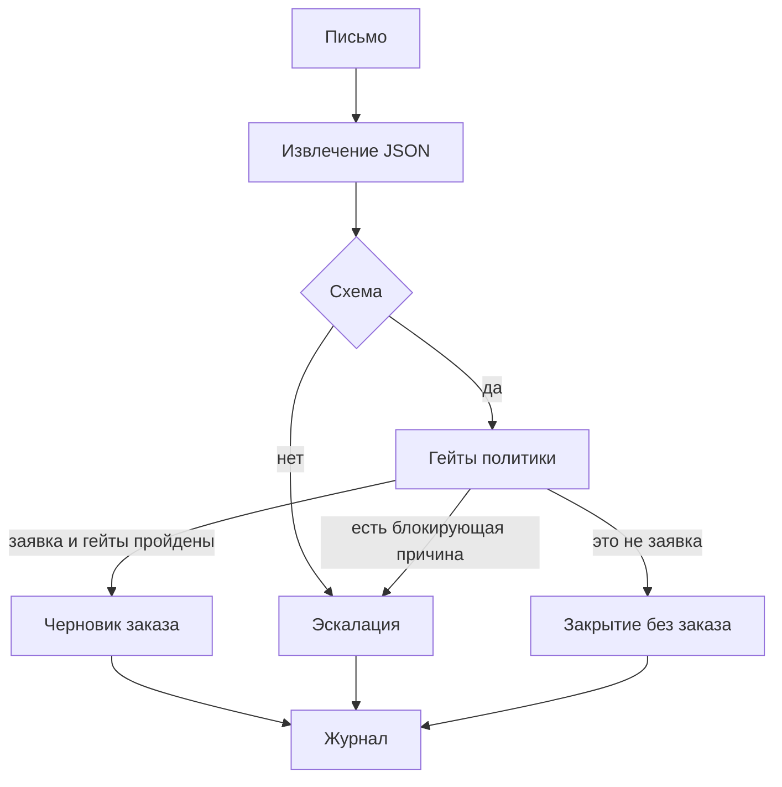

# Конвейер

Один проход. Повтор того же письма не создаёт второй заказ.

## Граница ответственности

Модель заполняет структуру: намерение, поля заказа, свою уверенность и список допущений. Она не ставит цену и не решает, можно ли отгружать.

Политика подтверждает поля по закрытым спискам.

Можно поправить значение, если извлечённый текст однозначно указывает на одну запись справочника. Так в MSG-006 выдуманный артикул заменён на каталожный, а цена взята из прайса. Замена записана в заказ.

Нельзя достроить пустое коммерческое поле. Пустой адрес не ищется в теле письма. Относительная дата вроде «до пятницы» не вычисляется вторым правилом. Количество «как обычно» не становится числом.

Ничья в справочнике — это эскалация, даже если модель уже выбрала одну из сторон. Так устроено MSG-010: «бумаги А4» подходят к двум позициям с разной ценой.

## Гейты

Порядок для заявки: схема и доступность ответа, намерение, уверенность, допущения, клиент, адрес, позиции, дата, лимит.

| Код | Когда останавливаем |
| --- | --- |
| `schema_invalid` | ответ не укладывается в схему |
| `extractor_unavailable` | ответа модели нет |
| `low_confidence` | уверенность ниже порога (low при пороге medium) |
| `data_gaps` | модель отметила нехватку данных |
| `model_escalate` | модель выставила escalate=true без других причин |
| `assumption_blocking` | модель додумала количество, артикул, единицу, адрес, дату, клиента или цену |
| `client_unresolved` | клиент не узнан по ИНН, домену и названию |
| `client_conflict` | эти сигналы расходятся |
| `address_missing` | адреса в структуре нет |
| `address_unresolved` | адрес не из карточки |
| `address_ambiguous` | подходят несколько точек |
| `sku_unresolved` | позиция не попала в каталог |
| `sku_unsupported` | артикул модели текстом позиции не подтверждён |
| `sku_ambiguous` | название подходит к нескольким артикулам |
| `sku_conflict` | артикул и название указывают на разный товар |
| `unit_mismatch` | единица не из каталога |
| `qty_invalid` | количество вне диапазона |
| `date_missing` / `date_unparsed` / `date_in_past` / `date_too_far` | даты нет, она не в формате ГГГГ-ММ-ДД, она в прошлом или дальше 45 дней |
| `credit_limit` | сумма по каталогу выше лимита карточки |
| `intent_unclear` / `intent_conflict` | непонятно, заявка ли это, либо метка «не заявка» спорит с составом |
| `source_changed` | текст письма изменился после уже записанного решения |

Уверенность проверяется всегда и не отменяет остальные гейты. Высокий балл при неизвестном клиенте всё равно эскалация.

## Действия

`src/case_lab/actions.py` пишет один артефакт:

- `out/orders/ORD-….json` — черновик, `status = draft`, `auto_posting = false`;
- `out/escalations/ESC-….json` — открытая эскалация, `not_approved = true`, даже если сумма уже посчитана;
- `out/closed/CLOSED-….json` — письмо без новой поставки.

Журнал `out/audit.jsonl` хранит решение, гейты, отпечаток входа, отпечаток промпта и версии. Текста письма в нём нет.

## Где что лежит

| Модуль | Роль |
| --- | --- |
| `extract.py` | промпт, фикстура или live-вызов, разбор JSON |
| `gates.py` | политика |
| `resolve.py` | клиент, адрес, артикул по справочникам |
| `actions.py` | действие на выходе |
| `audit.py` | запись журнала |
| `economics.py` | окупаемость из вводных |
| `pipeline.py` | сборка прохода и идемпотентность |
| `config.py` | чтение `.env` (Proxy API, вход, уведомления) |
| `runtime.py` | боевой запуск по настройкам |
| `adapters/` | файлы / HTTP / почта / уведомление менеджеру |
| `data/golden/` | эталон решений после политики |

Фикстуры и эталон — разные вещи. Фикстура может ошибаться. Эталон описывает, что должно получиться после гейтов.

## Два запуска одной сердцевины

| Команда | Зачем |
| --- | --- |
| `python -m case_lab demo` | запись экрана: файловый вход + фикстуры LLM, без токенов |
| `python -m case_lab live` | боевой контур по `.env` (Proxy API при `CASE_LLM=live`) |
| `python -m case_lab serve` | HTTP `POST /ingest` (нужен пакет `.[api]`) |
| `scripts/run_scheduled.ps1` | опциональный планировщик (аналог cron) вокруг `live` |

SMTP в `.env` — это не вход заявок, а **исходящая** почта для письма менеджеру. Пока `CASE_NOTIFY=file`, SMTP можно не заполнять.

## Что сменить, когда появятся доступы

- ключ Proxy API → только `.env`, команда `live`;
- почта IMAP / SMTP менеджеру → заполнить `.env` и дописать клиент в соответствующем адаптере;
- учётная система → забрать JSON черновика из `out/orders/` как непроведённый документ.

Гейты, журнал и запрет проведения при этой замене остаются. Проведение документа — новая версия политики и отдельное решение, не правка промпта.
